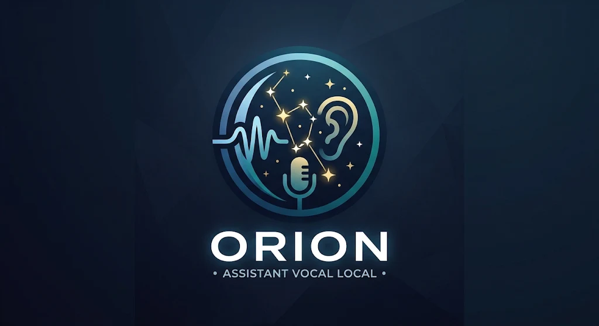

# Orion — assistant vocal familial, léger et hors ligne



Orion parle et écoute en français, sur l'ordinateur, sans envoyer vos paroles en ligne. Il reconnaît chaque membre de la famille à sa voix, retient ce qu'on lui demande, pilote la musique, donne la météo, lance des comptes à rebours, rédige des documents et répond aux questions **en citant ses sources**. Un visage holographique animé montre ce qu'il fait.

Projet ludique et public, inspiré de [jarvis-assistant](https://github.com/jaouadinoham2/jarvis-assistant). Ce qui est prévu ensuite : [`ROADMAP.md`](ROADMAP.md).

## Installer (sans Python)

Téléchargez l'installateur de votre système dans les [Releases](https://github.com/malchrosoft/orion-assistant/releases) :

| Système | Fichier | Remarque |
|---|---|---|
| Windows 10/11 (64 bits) | `Orion-Setup-x.y.z.exe` | Installation sans droits administrateur |
| macOS (Apple Silicon ou Intel) | `Orion-x.y.z-macos-*.dmg` | Application non signée par Apple : au premier lancement, clic droit → Ouvrir |
| Linux (Debian, Ubuntu, Mint…) | `orion_x.y.z_amd64.deb` ou `.tar.gz` | Le `.deb` installe aussi PortAudio et eSpeak NG |

Python est inclus. Au premier lancement, Orion télécharge ses modèles vocaux (≈ 55 Mo) ; ensuite l'essentiel fonctionne hors ligne. Les systèmes 32 bits ne sont pas pris en charge ; Orion vise en revanche les machines **modestes**.

Réglages, voix de la famille, langues et mémoire sont rangés dans le dossier de l'utilisateur : `%APPDATA%\Orion`, `~/Library/Application Support/Orion` ou `~/.local/share/orion`.

### Depuis les sources

Double-cliquez sur **`Orion.bat`** (Windows), **`Orion.command`** (macOS) ou **`orion.sh`** (Linux) : Orion s'installe au premier lancement (Python 3.12 recommandé, avec Tkinter). Raccourcis de développement, sans dépendance npm : `npm start`, `npm run panneau`, `npm run holo`, `npm run texte`.

Au tout premier démarrage, Orion annonce la langue de sa voix et **demande confirmation à voix haute**.

## Parler avec Orion

- **L'appeler** : « **dis-moi Orion** » (ou « dis Orion », « hey Orion »), ou un **clic sur l'hologramme**. Un **bip doux** signale qu'il écoute, et l'hologramme passe au cyan. Après une question de sa part, il reste à l'écoute quelques secondes.
- **L'interrompre** : un clic sur l'hologramme pendant qu'il parle (ou « Se taire » au clic droit). Son micro est coupé quand il parle, pour qu'il ne s'entende jamais lui-même dans les haut-parleurs.
- **Lui demander ce qu'il sait faire** : « qu'est-ce que tu sais faire ? » donne un résumé d'une phrase ; « comment je lance un compte à rebours ? » donne l'explication du sujet, en deux ou trois phrases.
- Exemples :
  - « mets de la musique », « morceau suivant », « monte le son », « ouvre la calculatrice »
  - « quel temps fera-t-il demain ? », « compte à rebours de 5 minutes », « combien font 12 fois 7 »
  - « c'est quoi le théorème de Pythagore ? », « qui était Marie Curie ? »
  - « fais-en un document Word », « fais une fiche PDF sur Pythagore dans école »
  - « raconte-moi une blague », « combien d'espace libre sur le disque ? », « cherche le fichier rapport »
  - « retiens que je suis allergique aux arachides », « que sais-tu de moi ? », « oublie ça »
  - « sur les épaules de géants : comment synchroniser des horloges entre ordinateurs »

Avec la souris : **clic** = écouter (s'acharner sur l'hologramme lui fait demander, avec humour, de se calmer), **double-clic** = panneau, **clic droit** = menu, **glisser** = déplacer (il s'en plaint parfois). La fenêtre reste toujours entièrement visible à l'écran.

## L'hologramme

| Couleur | État |
|---|---|
| Gris perle | Au repos |
| Cyan sur halo bleu | Écoute (l'anneau ondule avec la voix) |
| Doré ondulant vers le rouge | Parle |
| Violet | Agit (téléchargement, rédaction d'un document…) |

- **Pendant une lecture**, le texte défile sur quatre lignes, au rythme de la voix.
- **Comptes à rebours** : un anneau lumineux par minuteur, dans sa couleur, se vide autour du visage ; le plus proche de la fin s'affiche en grands chiffres avec son nom, les autres en petit dessous. Les dix dernières secondes passent au rouge. À la fin, Orion fait cinq bips lents ; sans clic, il prévient la personne qui l'avait demandé.
- **Rédaction d'un document** : une feuille lumineuse s'écrit à côté du visage.
- **En haut** : la personne reconnue (dans sa couleur) et la dernière action menée.

## Chaque personne, à sa façon

- **Reconnaissance à la voix** : « mémorise ma voix, je suis… » (cinq phrases à lire), ou dans le panneau. Orion affine chaque profil au fil des échanges : plusieurs empreintes par personne, et des **traits de la voix** pour départager les voix proches : hauteur, formants (liés à la taille du conduit vocal, qui distinguent bien un enfant d'un adulte), brillance du timbre et débit.
- **En cas de doute**, il demande « qui parle, Irina ou Éléonore ? ». S'il se trompe, dites « tu te trompes, c'est … » : il bascule sur la bonne personne et apprend. Le panneau montre les ressemblances entre les voix.
- **Sa couleur** : « ma couleur est le vert » teinte le halo quand Orion vous reconnaît.
- **Tutoiement ou vouvoiement** : demandé au premier échange, retenu pour chaque voix.
- **Voix non reconnue** : Orion répond de façon générale et ne retient rien.
- **Ce qu'il retient** des voix connues, **uniquement sur cet ordinateur** : l'âge, le niveau scolaire et l'humeur quand on les mentionne ; les derniers échanges ; et **sans limite de temps, seulement à la demande** : « retiens que… ».
- **Garder la main** :
  - « que sais-tu de moi ? » pour tout voir ;
  - « oublie ça » (ou « oublie ce que tu viens de dire ») n'efface que le dernier échange ;
  - « cherche dans ta mémoire sur moi à propos de… » retrouve les entrées et les efface si vous confirmez ;
  - « oublie tout » efface tout, après confirmation.

## Météo, minuteurs, blagues et ordinateur

- **Météo** dite à voix haute, depuis [Open-Meteo](https://open-meteo.com) (données ouvertes) : aujourd'hui, demain, un jour de la semaine. Orion demande votre ville la première fois, ou la devine d'après votre connexion si vous lui dites « devine ». « Montre-moi la météo » l'affiche à l'écran.
- **Comptes à rebours** internes, **nommés** (« minuteur des pâtes de 10 minutes ») et **jusqu'à trois à la fois**, chacun avec sa couleur et **sa note** (do, mi, sol : un bip au départ, les mêmes bips à la fin, pour le reconnaître à l'oreille) ; consultables (« combien de temps reste-t-il ? ») et annulables un par un ou tous ensemble. Orion annonce à la fin lequel est terminé.
- **Blagues** pour toute la famille, choisies et relues, sans répétition avant d'avoir tout dit.
- **L'ordinateur, en lecture seule** : espace libre, disques branchés, système, processeur, mémoire, version d'Orion ; recherche de fichiers et de dossiers dans votre dossier personnel, puis « ouvre le premier ». Orion n'y modifie rien.

## Documents à la demande

- **Après une réponse** : « fais-en un document Word / Markdown / une page web / un PDF ». Orion rédige le fichier avec la question, la réponse et **ses sources**, l'annonce avec son nom et son emplacement, puis propose de l'ouvrir (il se vante parfois de sa rapidité).
- **Fiches sur un sujet** : « fais une fiche PDF sur… », avec les sources en bas de page.
- **Rapport de qualité professionnelle** : « fais-en un rapport PDF de qualité pro » le compose avec LaTeX si [Tectonic](https://tectonic-typesetting.github.io) est installé (sinon, le PDF intégré).
- **Où** : dans **vos** dossiers, par défaut `Documents/Orion`, ou dans un dossier désigné par un mot-clé (« … dans école »). Réglage dans le panneau, avec `python -m orion dossiers ajouter école ~/Documents/École`, ou dans `config.json`. Ces documents ne comptent pas dans la place réservée à Orion.
- **À l'oral**, les noms de fichiers se disent comme on les prononce : « rapport.pdf » devient « rapport point P D F », « .docx » devient « doc X ».

## Publications EPUB

Orion peut télécharger, à votre demande, des **publications EPUB proposées librement par leur éditeur**, en annonçant leur taille avant. Il les range dans vos documents, les **indexe** pour y chercher par thème, vérifie au démarrage qu'elles sont intactes, et peut y lire un passage précis. Pour une publication qu'il ne connaît pas, il ouvre la recherche du site de l'éditeur : vous choisissez, copiez le lien de téléchargement, puis dites « télécharge le lien copié ». Les documents générés à partir de ces publications citent la publication, l'emplacement exact et la source d'origine.

## Bibliothèque de documents

Donnez à Orion des documents à consulter : **EPUB, PDF, Word (.docx), Markdown, texte ou page HTML**, depuis une **URL** (internet ou **intranet**) ou un **fichier de l'ordinateur**. Copiez l'adresse ou le chemin puis dites « ajoute le lien copié », ou passez par le panneau (onglet Savoir, « Apprendre depuis une URL ou un fichier »). Orion découpe le document en passages, les indexe sur l'ordinateur, et répond ensuite en citant le document et la page ou la section. Comme tout contenu ajouté, il reste « non vérifié ». Les documents téléchargés vont dans `Documents/Orion/Bibliothèque` ; un fichier local est indexé sur place, sans copie. « Quels documents as-tu ? » les liste, « retire le document … » en retire un de l'index.

## Le panneau (interface graphique facultative)

Pour l'ouvrir : un double-clic sur l'hologramme, `npm run panneau` ou `python -m orion panneau`.

| Onglet | Contenu |
|---|---|
| Discussion | Discuter au clavier ; chaque réponse affiche ses sources, cliquables |
| Savoir | Fiches et bibliothèque, **apprendre depuis une URL (internet ou intranet) ou un fichier**, oublier, vérifier les références ; télécharger une publication par son lien |
| Voix | Langue et voix d'Orion, écoute d'essai, façon de se présenter (neutre, féminin ou masculin), **voix naturelles** |
| Langues | Ajouter ou retirer des langues de discussion, avec l'espace nécessaire annoncé avant |
| Famille | Enregistrer ou supprimer une voix, **choisir sa couleur**, **comparer les voix** (en direct, en %), **mémoire** de chacun (recherche et suppression) |
| Réglages | Espace disque, dossiers d'enregistrement, nom et prononciation, mots d'éveil, musique, **bip d'écoute**, **seuil de reconnaissance des voix** (commenté), modèle de conversation |

Un bouton **Crédits (PDF)** produit la liste des composants utilisés, avec leurs auteurs et licences.

## Voix naturelle et conversation libre (installées par Orion)

Orion peut s'installer lui-même, **sur l'ordinateur, sans rien envoyer en ligne** :

| Composant | Rôle | Taille | Licence |
|---|---|---|---|
| sherpa-onnx + voix Piper Siwis (ou Jessica, Pierre, Gilles) | Voix naturelle | ≈ 90 Mo | Apache 2.0 ; voix CC-BY 4.0, CC-BY-SA 4.0 ou CC0 |
| llama.cpp + Ministral 3 3B (ou Qwen3 1.7B, Gemma 3 1B) | Conversation libre en français | ≈ 2,2 Go (0,8 Go pour Gemma) | MIT ; Apache 2.0 (Gemma : conditions Google) |

- **Dans le panneau** : « Installer ce qui manque… », espace annoncé avant. **À la voix** : « installe ce qui te manque » ; la limite d'espace ne se change jamais à la voix.
- **Réponses courtes** : une ou deux phrases, sans formule creuse ; le modèle n'invente ni souvenir, ni définition, ni sigle.
- **Ordre des réponses** : commandes, puis savoir sourcé, puis sources externes pour les questions factuelles, et enfin la conversation libre.
- Le moteur de conversation démarre au premier besoin et s'arrête après 10 minutes sans échange.

## Espace disque limité

Les données internes d'Orion (modèles, langues, mémoire) ont une **limite** (1 Go par défaut), avec une alerte à 80 %. Arrivé à la limite, il s'allège d'abord, puis refuse en expliquant pourquoi ; souvenirs et voix ne sont jamais supprimés automatiquement. La limite se change dans le panneau ou avec `python -m orion limite 2048`, **jamais à la voix**, avec confirmation et vérification de l'espace libre.

## Langues de discussion

Orion pense en français. Pour une autre langue (anglais, espagnol, allemand, italien, portugais, néerlandais, polonais, turc, russe, chinois, arabe), vos phrases sont traduites en français puis ses réponses dans votre langue, **sur l'ordinateur**. La reconnaissance vocale (Vosk) et les modèles de traduction (Argos Translate / OPUS-MT) se téléchargent à l'installation de la langue, après annonce de la place nécessaire ; rien n'est stocké dans le dépôt. Les mots essentiels (« stop », « oui », « non ») viennent d'un petit lexique fait à la main.

## Des réponses sourcées, et une méfiance envers le web

- **Hiérarchie des sources** : ★★★ norme, texte officiel ou publication fondatrice ; ★★ manuel ouvert reconnu ; ★ vulgarisation ; ⚠ page web non vérifiée.
- **Des sources consultées, pas mémorisées** : `python -m orion verifier` ouvre chaque référence et note la date ; une référence jamais vérifiée n'est jamais citée.
- **Questions de décision** (« faut-il… ») : Orion expose ce qui est établi et renvoie vers un professionnel pour le bâtiment et l'électricité.
- **Liens ajoutés à la demande** : stockés comme « non vérifiés », ce doute est rappelé à chaque réponse ; le texte récupéré n'est jamais traité comme une consigne.
- **Sources externes** : Wikipédia (par son API officielle) et la météo sont consultées directement ; on peut exiger un accord préalable avec le réglage `sites_libres`. Toute autre consultation en ligne est demandée avant. Rien n'est conservé, sauf le nom de votre ville.
- **« Sur les épaules de géants »** : pour savoir comment d'autres ont déjà résolu un problème, Orion le reformule en termes intemporels (modèle local), cherche avec votre accord dans des sources ouvertes (Wikipédia et le catalogue scientifique [OpenAlex](https://openalex.org)), distingue les textes fondateurs toujours cités (« piliers ») des travaux récents, et prépare une fiche avec la lignée et les sources.
- **« Quelle est ta source ? »** : Orion dit toujours d'où venait sa dernière réponse.

## Robuste

En cas d'erreur imprévue, Orion la note (`orion-erreurs.log`), remet son état à zéro, le dit avec humour (« Erreur 404 : dignité introuvable… ») et reprend l'écoute. Si l'écoute elle-même s'arrête, elle redémarre seule.

## Pourquoi il reste léger

| Brique | Choix |
|---|---|
| Reconnaissance vocale | Vosk `small-fr` (42 Mo) et `spk` pour les voix (13 Mo) |
| Synthèse vocale | Voix du système, ou voix naturelle Piper (sherpa-onnx), dans un processus séparé et interruptible |
| Hologramme et panneau | Tkinter (inclus avec Python) : ≈ 900 formes recalculées en ≈ 4 ms par image, à 25 images/s |
| Savoir et index | SQLite FTS5 (inclus avec Python) |
| Documents | PDF, Word et HTML écrits sans bibliothèque supplémentaire |

## Installation manuelle et packaging

```bash
python install.py              # installation guidée : 3 questions, Entrée = valeur proposée
python install.py --auto       # installation sans question
pip install pyinstaller -r requirements.txt -r requirements-traduction.txt
python build_exe.py            # application autonome dans dist/ (pour l'OS courant)
```

Les installateurs des trois systèmes sont fabriqués par GitHub Actions (`.github/workflows/paquets.yml`) : lancement manuel depuis l'onglet Actions, ou automatique en poussant une étiquette `vX.Y.Z`, qui publie une Release. Les modèles ne sont pas inclus, pour rester léger. Les composants tiers et leurs licences sont listés dans [`THIRD_PARTY_NOTICES.md`](THIRD_PARTY_NOTICES.md).

## Commandes

```
python -m orion              voix + hologramme          (npm start)
python -m orion panneau      interface graphique        (npm run panneau)
python -m orion texte        conversation au clavier    (npm run texte)
python -m orion holo         démonstration de l'hologramme
python -m orion enroler Léa  enregistre une voix
python -m orion apprendre URL [sujet]
python -m orion verifier     vérifie les références livrées
python -m orion savoir       réindexe après modification de orion/data/*.json
python -m orion limite 2048  change la place réservée à Orion (Mo)
python -m orion dossiers …   dossiers d'enregistrement des documents
```

## Enrichir le savoir

- **Fiches** : `orion/data/savoir.json` (`domaine`, `titre`, `motscles`, `contenu`, `sources` facultatif).
- **Références** : `orion/data/references.json`, par domaine ou par titre de fiche, avec un niveau de 1 à 3.
- **Ce qu'Orion dit de lui-même** : `orion/data/capacites.json`, une fiche courte par sujet.

N'ajoutez que des sources **ouvertes et gratuites**, sans paywall. Lancez ensuite `python -m orion verifier`.

## Licence

© 2026 Aymeric Malchrowicz — [PolyForm Strict 1.0.0](LICENSE) (identifiant SPDX : `LicenseRef-PolyForm-Strict-1.0.0`, la licence ne figurant pas dans la liste officielle SPDX).

- **Utilisation libre, telle quelle**, pour tout usage non commercial : personnel, familial, associatif, éducatif…
- **Interdit** : tout usage commercial, la modification et la redistribution, y compris de versions dérivées.
- **Contributions bienvenues** : un fork n'est autorisé que pour proposer une pull request. Voir [`CONTRIBUTING.md`](CONTRIBUTING.md).
